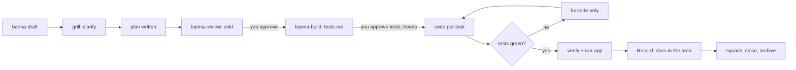

# Banna (بنّا)

ورک‌فلوی plan → test → code → record. منبع حقیقت: اسکیل‌ها در `.agents/skills/banna-*` (با symlink از `.claude/skills`) و کانفیگ `.banna/config.yaml`. این فایل فقط خلاصه‌ی طراحی است.

پایه: اسکیل‌های `plan-*` از `vanenshi/skills`، با تغییر نام به `banna-*` و افزوده‌های زیر. متن اصلی تا جای ممکن دست‌نخورده مانده.

## اسکیل‌ها

| اسکیل | نقش | قدیم |
|---|---|---|
| `banna-draft` | ساخت پلن، ریویوی سرد، تخصیص مدل به هر تسک | `plan-draft` |
| `grill` | مصاحبه‌ی بی‌وقفه با درخواست‌دهنده تا همه‌چیز روشن شود: یک سؤال در هر نوبت با پاسخ پیشنهادی، به ترتیب وابستگی تصمیم‌ها، پاسخ از کدبیس اگر ممکن بود، به‌روزرسانی `CONTEXT.md` همان area هم‌زمان. `banna-draft` در فاز ۳ آن را در همان سشن اجرا می‌کند. مستقل هم قابل اجرا است | فاز grill در `plan-draft` + اسکیل `grilling` |
| `banna-review` | ریویوی سرد پلن (APPROVE / REVISE) | `plan-review` |
| `banna-build` | ساخت پلن تأییدشده: تست red، تأیید و freeze، کد، verify، Record، squash، close | `plan-execute` |
| `banna-handoff` | کار خارج از scope | `plan-handoff` |
| `banna-archive` | انتقال تمام‌شده‌ها به archive (جدید) | |
| `commit` | کامیت با Conventional Commits، گروه‌بندی بر اساس concern (ادغام `auto-commit` و `conventional-commits`). `banna-build` برای هر تسک و close-out از آن استفاده می‌کند | |
| `squash-commit` | فشرده‌کردن کامیت‌های run به یک کامیت برای هر feature، بدون تغییر tree و **بدون branch پشتیبان** (sha اصلی در خروجی و reflog می‌ماند). `banna-build` در مرحله ۱۰ آن را صدا می‌زند | |

## جریان



## چیزهایی که به متن vanenshi اضافه شد

1. **کانفیگ** `.banna/config.yaml`: مسیرها، areaها، کاتالوگ مدل‌ها، مدل هر مرحله به‌ازای سختی، دستور تست‌ها، قوانین freeze، archive. هر اسکیل در شروع آن را می‌خواند و اگر نبود متوقف می‌شود.
2. **مدل برای هر تسک:** `banna-draft` به هر تسک `Difficulty: S|M|L` و `Model:` می‌دهد (اولین مدل مجاز و در دسترس در `stages`). `banna-build` هر تسک را در subagent با همان مدل اجرا می‌کند. بعد از دو شکست یکسان، تسک یک tier بالا می‌رود و ریشه‌یابی با `root_cause` انجام می‌شود.
3. **تست‌اول و freeze:** از نسخه‌ی خودت (کامیت red، `/commit`، squash، `/run-app`، تسک‌های موازی). افزوده: تست‌ها را تو تأیید می‌کنی و freeze می‌شوند (`scripts/check-frozen.sh`). تست fail یعنی کد را درست کن. تغییر تست فقط با تأیید صریح تو و کامیت جدا (`test(amend)`).
4. **Record:** سندهای دانش (adr، conventions، `CONTEXT.md`، `stack.md`) در `docs` همان area (`api/docs`، `web/docs`) نوشته می‌شوند و یک‌خطی‌شان به `CLAUDE.md` همان area اضافه می‌شود. فقط چیز بین‌سرویسی در `docs` ریشه می‌رود. قوانین ADR از vanenshi بدون تغییر.
5. **شناسه پلن:** `YYYY-MM-DD-NNN-<slug>.md`، `NNN` شماره‌ی پلن در همان روز (`001`، `002`، …). شناسه = تاریخ + `NNN`، مثل `2026-11-13-001`. هرگز دوباره استفاده نمی‌شود.
6. **archive:** `.banna/plans/archive/<yyyy-mm>/` و `.banna/handoffs/archive/<yyyy-mm>/`. `banna-build` پلن done را خودش منتقل می‌کند و `banna-archive` جاروی دستی است.

## ساختار

```
.banna/
  config.yaml
  DESIGN.md
  plans/      2026-11-13-001-<slug>.md  (فقط زنده)   archive/2026-11/
  handoffs/   2026-11-13-<slug>.md      (open/planned) archive/2026-11/
```

## محدودیت واقعی

یک اسکیل نمی‌تواند مدل سشن اصلی را عوض کند. سشن اصلی هماهنگ‌کننده است و کار هر تسک در subagent با `model:` صریح انجام می‌شود. اگر مدل سشن از نیاز پلن ضعیف‌تر باشد و `selection.enforcement: stop` باشد، `banna-build` متوقف می‌شود.

## از Esi نیاوردم

board و product-manager، `from_item/from_brief`، گیت roadmap، سبک STE، `checks.md`. اگر خواستی بعداً جدا اضافه می‌شوند.
