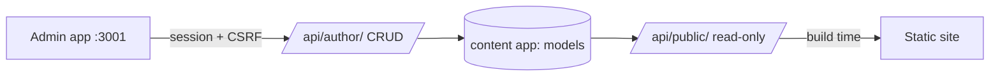

# Content models and APIs

> **Run with:** `sonnet` / `medium` effort — every task is a well-specified Django/DRF change in a small, fresh codebase with tests written first. Four tasks (B3, C1, C2, D1) are rated L; per the config's `prefer: cheapest` they still resolve to sonnet and escalate to opus after two identical failures.

## 1. Goal & scope

The backend gets the content models and two APIs. The Author writes portfolio and blog content (English and Persian) through the local admin app; the static public site reads it at build time. Content lives only in the local database, never in git.

**In scope:**
- `core`: shared base models (public uuid, audit, soft delete with cascade) and a translation base.
- New `content` app: Image, Tag, Post, Profile (+links), Skill group (+skills), Experience, Education, Project — each with a Translation model.
- Author API (`/api/author/`) and Public API (`/api/public/<locale>/`), the image upload endpoint, tests, and both SDKs regenerated.

**Out of scope:**
- Admin and public screens — the next plans.
- The site build downloading images and rewriting URLs — contract only here (§2).
- Publish and backup commands — separate plan.
- Image resizing or variants — keeps Pillow use to validation.

## 2. Assumptions & open questions

**Safe assumptions:**
- Ids: integer `pk` plus a public `uuid` on every model; the Author API addresses rows by `uuid`. Soft delete on every content model.
- Base models come from roshan-clinic's `core/models.py` (`PublicIdModel`, `AuditModel`, `SoftDeleteModel`), extended with papasi's cascade (soft-deleting a parent soft-deletes its translations; restore reverses it). You said "copy from papasi"; roshan's is the newer base, papasi adds the cascade it lacks.
- Locales are `en` and `fa` (from `LANGUAGES`, `backend/src/config/settings.py:140`). A Content item needs at least one Translation; either locale may be missing.
- Only Post and Project have draft/published, per Translation. Every other kind is public as soon as it is saved and not deleted.
- Ordering: Experience and Education by start date descending; Skill group, Skill and Project by an Author-set `position`; Posts by published date descending.
- Markdown is stored as written. Rendering and sanitizing is the site's job; the Author API only limits length.
- Slug: lowercase ASCII `[a-z0-9-]`, unique among non-deleted rows. Post and Project slugs become read-only once any Translation is published; a Tag slug is read-only from creation (Tags have no publish state).
- Foreign keys: every Image FK (cover, avatar) is `SET_NULL`, never `CASCADE`, so deleting an Image can never delete a Post. Translation → parent, Skill → Skill group and ProfileLink → Profile are `CASCADE` (the soft-delete cascade follows them). Many-to-many links (tags, project skills) are not touched by the cascade.
- Translation fields, by kind: Post and Project — `title`, `summary`, `body` (Markdown), `status`, `published_at`; Profile — `name`, `headline`, `summary`, `location`; Experience — `role`, `location`, `description`; Education — `degree`, `description`; Skill group — `title`; Tag — `name`; Image — `alt`. A published Post or Project Translation needs a non-empty `title` and `body`.
- Creating an Image: `POST /api/author/images/` uploads the file only. The alt texts are then set with `PATCH /api/author/images/<uuid>/` using the same nested `translations` as every other kind. The Public API gives an empty `alt` when the requested locale has none.
- Uploads: JPEG, PNG or WebP, at most 5 MB and 4000 px per side, stored under `MEDIA_ROOT/images/<yyyy>/<mm>/`. A soft-deleted Image reads as `null` in the Public API.
- Unauthenticated Author-API requests answer 403, not 401, because `DEFAULT_AUTHENTICATION_CLASSES` is `SessionAuthentication` alone (`backend/src/config/settings.py:197`).
- The Public API returns an Image as `{url, width, height, alt}` with an absolute `url` built from `BACKEND_ORIGIN`. How the static build copies those files into the export is a later frontend plan.

**Residual risks / unknowns for reviewer:**
- Whether `@hey-api/openapi-ts` 0.99 can filter operations by tag or path so the public SDK carries no Author operations; task D2 verifies it and falls back to a separate schema view if not.
- Conditional unique constraints are tested on SQLite only; PostgreSQL is checked once by hand in B3 (`DATABASE_URL` pointing at a scratch database).

**Bookkeeping:**
- Terms resolved → `backend/docs/CONTEXT.md` (created during the grill).

## 3. Implementation tasks

### Phase A — Shared building blocks

- [x] **A1. Add the base models to `core`**
  - Files: `backend/src/apps/core/models.py` (new), `backend/src/apps/core/tests/test_soft_delete.py` (new), `backend/src/apps/core/tests/softdelete_app/` (new), `backend/src/config/settings_test.py`
  - Change: copy `PublicIdModel`, `AuditModel`, `SoftDeleteQuerySet/Manager/Model` from roshan-clinic `backend/src/apps/core/models.py`; add the cascade `_soft_delete`/`restore` from papasi `papasi-api/papasi/apps/core/models.py`. The cascade follows reverse FKs with `on_delete=CASCADE` to other `SoftDeleteModel`s only.
  - The test needs a parent and a child model, and `core` has none: add a test-only app `backend/src/apps/core/tests/softdelete_app/` (`Parent`, `Child` with a CASCADE FK) and list it in `INSTALLED_APPS` in `backend/src/config/settings_test.py`. pytest-django creates the tables of an app with no migrations.
  - Difficulty: M
  - Model: sonnet

- [x] **A2. Add the translation base to `core`**
  - Files: `backend/src/apps/core/translations.py` (new)
  - Change: an abstract `TranslationModel` (`locale` limited to `LANGUAGES`, soft delete) and a `PublishableTranslation` mixin (`status` draft/published, `published_at` set on first publish). Parent FK and the `(parent, locale)` unique constraint are declared per concrete model, conditional on `is_deleted=False`.
  - Difficulty: M
  - Model: sonnet

- [x] **A3. Add Pillow and the upload settings**
  - Files: `backend/pyproject.toml`, `backend/uv.lock`, `backend/src/config/settings.py`, `backend/.env.example`
  - Change: add `pillow`; add the two upload limits (`IMAGE_MAX_BYTES`, `IMAGE_MAX_SIDE`) next to `MEDIA_URL`/`MEDIA_ROOT` (`settings.py:161-162`, already present).
  - Difficulty: S
  - Model: sonnet

### Phase B — Content models

- [x] **B1. Add the `content` app with Image, Tag and Post**
  - Files: `backend/src/apps/content/` (new: `apps.py`, `models/`), `backend/src/config/settings.py` (add to `INSTALLED_APPS`, `settings.py:42`)
  - Change:
    - `Image` (file, width, height) + `ImageTranslation(alt)`.
    - `Tag` (slug) + `TagTranslation(name)`.
    - `Post` (slug, cover Image `SET_NULL`, tags) + `PostTranslation(title, summary, body, status, published_at)`.
  - Difficulty: M
  - Model: sonnet

- [x] **B2. Add Profile, Skill group, Experience, Education and Project**
  - Files: `backend/src/apps/content/models/` (new modules)
  - Change (fields per §2):
    - `Profile` (email, avatar Image `SET_NULL`) + `ProfileTranslation` + `ProfileLink(kind, url, position)`.
    - `SkillGroup` (position) + translation(title); `Skill(group, name, position)`.
    - `Experience(company, company_url, start_date, end_date)` + translation.
    - `Education(institution, start_date, end_date)` + translation.
    - `Project(slug, repo_url, live_url, featured, position, cover Image `SET_NULL`, skills)` + publishable `ProjectTranslation`.
  - Difficulty: M
  - Model: sonnet
  - Profile gets no phone field, by design.

- [x] **B3. Add the constraints and the initial migration**
  - Files: `backend/src/apps/content/models/`, `backend/src/apps/content/migrations/0001_initial.py` (generated)
  - Change: conditional `UniqueConstraint`s (slug; `(parent, locale)`) on `is_deleted=False`; a singleton rule for `Profile`; check constraints for slug format and date order. Run `makemigrations content` and keep the result. Check the Profile singleton and the delete-then-reuse path once on PostgreSQL by hand (§2).
  - Difficulty: L
  - Model: sonnet
  - Why: soft delete plus uniqueness is the part most likely to be wrong on both SQLite and PostgreSQL.

### Phase C — Author API

- [x] **C1. Add services and serializers with nested translations**
  - Files: `backend/src/apps/content/services.py` (new), `backend/src/apps/content/api/serializers.py` (new)
  - Change: serializers carry `translations: [{locale, ...}]`; a write replaces the whole set. Validation: locale in `LANGUAGES` and unique within one write; a published Post or Project Translation needs a title and body; Post and Project slugs immutable once any Translation is published, Tag slugs from creation. Services set `created_by`/`updated_by`.
  - Difficulty: L
  - Model: sonnet

- [x] **C2. Add the Author viewsets and routes**
  - Files: `backend/src/apps/content/api/author_views.py` (new), `backend/src/apps/content/api/author_urls.py` (new), `backend/src/config/urls/__init__.py` (add `path("api/author/", ...)`, near `urls/__init__.py:15`)
  - Change: CRUD for every kind, `IsAuthenticated`; `DELETE` soft-deletes; `POST <id>/restore/`; `?deleted=true` lists deleted rows; addressed by `uuid`; paginated with the existing `DefaultPagination`; OpenAPI tag `Author`.
  - Difficulty: L
  - Model: sonnet

- [x] **C3. Add the image upload endpoint**
  - Files: `backend/src/apps/content/api/author_views.py`, `backend/src/apps/content/api/serializers.py`
  - Change: multipart `POST /api/author/images/` uploads the file only; validate type by decoding with Pillow, byte size and dimensions against the limits from A3; store and record width/height. Alt texts arrive later by `PATCH` with nested `translations` (§2).
  - Difficulty: M
  - Model: sonnet

### Phase D — Public API and SDKs

- [x] **D1. Add the Public read-only views**
  - Files: `backend/src/apps/content/api/public_views.py` (new), `backend/src/apps/content/api/public_urls.py` (new), `backend/src/apps/content/selectors.py` (new), `backend/src/config/urls/__init__.py`
  - Change: `GET /api/public/<locale>/` for posts (list; detail by slug), tags, projects (list; detail), profile, skills, experience, education. `AllowAny`, no authentication. One selector module decides what is public: non-deleted, and for Post/Project only published Translations in that locale. Unknown locale → 404. OpenAPI tag `Public`.
  - Difficulty: L
  - Model: sonnet

- [ ] **D2. Split the SDKs by tag and regenerate them**
  - Files: `frontend/openapi-ts.config.ts`, `admin/openapi-ts.config.ts`, `frontend/src/api/backend/generated/`, `admin/src/api/backend/generated/`
  - Change: the public site's SDK keeps only `Public` operations; the admin app's keeps `Author` and `Auth`. Regenerate both against the running backend.
  - Difficulty: M
  - Model: sonnet
  - If the generator cannot filter by tag, add a second schema view limited to `/api/public/` and point the frontend config at it.
  - Generation needs the backend running (`cd backend && uv run python manage.py runserver`): both configs read `http://localhost:8000/api/schema/`.

### Phase E — Route guard

- [ ] **E1. Add the route-security test**
  - Files: `backend/src/apps/core/tests/test_route_security.py` (new)
  - Change: walks the URL conf with no session. Explicit allowlist of routes that answer without one: `/api/public/*`, `/api/health/`, `/api/auth/csrf/`, `/api/auth/login/`, `/api/schema/`, `/api/docs/`. Every other route — all of `/api/author/`, plus `/api/auth/logout/` and `/api/auth/me/` — must answer 403. A new route fails the test until someone puts it on a list.
  - Difficulty: M
  - Model: sonnet

## 4. Definition of done

- [ ] Base models soft-delete, cascade to children, restore, hide from the default manager and hard-delete on request — verify: `backend/src/apps/core/tests/test_soft_delete.py` — unit — `delete()` sets `is_deleted` on a parent and its translations; `restore()` reverses it; `Model.objects` hides deleted rows, `objects_default` shows them; `hard_delete()` removes the row.
- [ ] One Translation per locale per item, and one slug per live item, even after deletes — verify: `backend/src/apps/content/tests/test_constraints.py` — unit — second `(post, "en")` row fails; a soft-deleted one frees the slot; a duplicate live slug fails and a reused slug of a deleted item passes; a second Profile fails.
- [ ] The Profile cannot hold a phone number — verify: `backend/src/apps/content/tests/test_profile_privacy.py` — unit — `Profile`, `ProfileTranslation` and `ProfileLink` have no field named `phone`; the Public profile payload's keys equal an exact expected set.
- [ ] The Author API rejects anyone not signed in — verify: `backend/src/apps/core/tests/test_route_security.py` — contract — every `/api/author/` route, `/api/auth/logout/` and `/api/auth/me/` answer 403 without a session; the routes that answer without one equal the allowlist in E1 exactly.
- [ ] The Author can create, change, delete and restore content with nested translations — verify: `backend/src/apps/content/tests/test_author_api.py` — integration — create a post with `en` and `fa` in one call; a later write replaces the set; publishing without a body is 400; changing the slug after publishing is 400; `DELETE` hides it and `restore/` brings it back; the CSRF token is enforced on writes (a client built with `APIClient(enforce_csrf_checks=True)`; add it as a fixture in `backend/src/apps/conftest.py`).
- [ ] The Public API shows only what is published and live — verify: `backend/src/apps/content/tests/test_public_api.py` — integration — a draft Translation, a soft-deleted post and a locale without a Translation are absent; the unknown locale is 404; no session is needed; responses carry the `{success, message, result, meta}` envelope.
- [ ] Image uploads are validated and carry translated alt text — verify: `backend/src/apps/content/tests/test_images.py` — integration — a PNG is accepted and its width/height recorded; a text file renamed `.png`, a file over 5 MB and one over 4000 px are rejected; the Public API returns `{url, width, height, alt}` with the alt of the requested locale.
- [ ] The two SDKs are disjoint — verify: `backend/src/config/tests/test_schemas.py` — contract — every operation is tagged `Public`, `Author` or `Auth`; there is at least one `Public` and one `Author` operation; every `Public` operation is `GET` under `/api/public/` and every `Author` one is under `/api/author/`. And, with the backend running, `cd frontend && rm -rf src/api/backend/generated && pnpm generate:api && ! grep -rq "/api/author/" src/api/backend/generated` — command.
- [ ] Nothing regressed — verify: `cd backend && uv run ruff check . && uv run ruff format --check . && uv run ty check && uv run pytest && uv run python manage.py makemigrations --check --dry-run` — command — all pass, 0 ty errors, no pending migrations; and `cd admin && pnpm lint && pnpm test && pnpm build`, `cd frontend && pnpm lint && pnpm test && pnpm build` — command.

## 5. Risk & rollback

| Risk | Severity | Mitigation |
|---|---|---|
| Soft delete breaks uniqueness (a deleted slug blocks a new one) | high | Conditional unique constraints (B3), tested on the delete-then-reuse path |
| A private field reaches the static HTML (phone, drafts) | high | No phone field exists; one selector module decides what is public (D1); tests assert exact payload keys and draft absence |
| Nested translation writes lose data on a partial update | med | Replace-whole-set semantics, tested (C1); the Author app always sends the full set |
| Uploaded files fill the disk or carry a bad payload | med | Decode with Pillow, size and dimension caps (C3) |
| SDK split fails and the public site ships Author operations | med | Contract test plus the `grep` check (D2); fallback schema view |
| Cascade soft delete reaches a row it should not (an Image FK left `CASCADE`) | high | Every Image FK is `SET_NULL` (§2); `test_soft_delete.py` covers the cascade on the test app |
| A constraint behaves differently on PostgreSQL than SQLite | med | One manual PostgreSQL check in B3 |
| Content lost with the machine | med | Out of scope; backups are the Author's (see `backend/docs/README.md`) |

- **Rollback:** `git revert` the plan's commits and delete `backend/db.sqlite3` (no real content exists yet). If content already exists, restore the database from the backup taken before running the migration.
- **Irreversible:** the initial `content` migration, once real content is entered; the public API shape, once the site is built against it.

## 6. Skills Needed

- `commit` (project) — for: every task — Conventional Commits, one commit per task.
- `squash-commit` (project) — for: the close-out — one commit per feature.
- `ruff` (global) — for: A1–E1 — lint and format rules the project enforces.
- `uv` (global) — for: A3 — adding the dependency and regenerating the lockfile.

## 7. Record (docs — /banna-build writes them)

- **Context** (`backend/docs/CONTEXT.md`) — already created during the grill; the build keeps it in sync with any term the code renames.
- **Convention** (`backend/docs/conventions/`, new) — three new rules: a translatable model stores text in a Translation row with the parent FK and a conditional unique `(parent, locale)`; every Public endpoint reads through `selectors.py` and names `AllowAny`; content models soft-delete and uniqueness is conditional on `is_deleted=False`.
- **Index** (`backend/CLAUDE.md`, new) — one line per backend doc (`docs/README.md`, `docs/CONTEXT.md`, the conventions); backend has no `AGENTS.md`, so it imports nothing.
- No ADR: the "Profile has no phone field" invariant is caught by a test (gate 2), and the other rules become convention rules.

## Execution log

- Base commit: `b132895` on branch `feature/content-models` (baseline of the existing work committed first, on `main`).
- Models: all tasks `sonnet`, run inline by the sonnet session.
- Tests are written once, for all phases, in one red commit (the contract is fully specified in §4).
- Frozen tests: `backend/src/apps/content/tests`, `backend/src/apps/core/tests`, `backend/src/apps/conftest.py`, `backend/src/config/tests/test_schemas.py` @ `f03a900`
- B3: the constraints are declared on the models in B1/B2; B3 added the initial migration. Checked once on PostgreSQL 15 (scratch database, dropped after): duplicate live slug, bad slug format and a second live profile are rejected, and a deleted post's slug is reusable.
