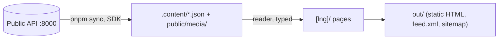

# Public site: pages, build-time content, SEO and feeds

> **Run with:** `sonnet` / `medium` effort — mostly specified pages on a known stack, tests first. Tasks rated L
> (A1, A2, B3, D4) run on sonnet. No task ever runs on opus (requester's rule): after two identical failures a task
> stays on sonnet and the main session does the root-cause analysis.

## 1. Goal & scope

Build the public site in `web/` on the API that already exists: a bilingual (`fa` RTL, `en` LTR) static export with a
home page, a resume page, posts, projects, tags, contact and a 404. Content is read from the Public API **once, before
`next build`**, into a local snapshot (JSON plus downloaded images), because the API runs only on the author's machine
and its image URLs are unreachable from GitHub Pages. Visuals come from the Figma files (§2).

**In scope:**
- Design tokens (light and dark with a toggle), fonts, header/footer, language switch.
- Pages per locale: home, about/resume, posts list and detail, projects list and detail, tags index and tag page, contact, 404.
- Snapshot step (`pnpm sync`, run by `prebuild`), Markdown rendering with code blocks, SEO (metadata, canonical, hreflang, Open Graph, JSON-LD), sitemap, RSS, icons, a default Open Graph image.
- Fixing the Public API's OpenAPI schema so list endpoints are typed as arrays (A1), and regenerating the SDK.
- Component and page tests, and an export check on `out/`.

**Out of scope:**
- Search — dropped by the requester for this plan.
- Testimonials — in the template, but no API model; no backend change now.
- Remaining admin screens, the GitHub Pages workflow, domain, content publishing and backups, Lighthouse and accessibility audits beyond the checks named in §4 — later plans.
- Pagination of lists — assumed a small number of posts and projects.
- Per-post generated Open Graph images — posts use their cover image, else the site image.

## 2. Assumptions & open questions

**Design sources (Figma, read through the MCP):**

| File | Used for |
|---|---|
| Illustration-Based Portfolio Website Template (`eTEYdoqmxEjUpUNlypwRPs`, frames `Boy` 178:362, `Girl` 410:1016, plus `/Responsive` at 375 px) | Home and layout: hero, skills tiles, black Experience band, About with framed illustration, numbered Projects, contact. Header: logo, About / Skills / Project / Contact, a **Resume** button |
| Blogs and Articles Design (`c2dDsBhvEQiPJmDxmXzjgl`, frame 1:2) | Post page: centered card on grey, serif, date, dashed divider, quote blocks, highlight, tooltip, references box |
| Code Snippet Component (`JEcslpRqCqnuz4WBYPSxiA`, frame 6:186) | Code blocks: language label and a Copy button on a dark block |
| WYSIWYG Text Editor UI Kit (`pR19UHzQlhvaUMcaASe3nZ`) | Not used: it is a toolbar kit for the admin editor |

**Safe assumptions:**
- Tokens follow the template: white page, black "bands" (Experience, Projects); in dark mode the page is near-black and bands one step lighter. Tokens live once in `web/src/app/globals.css`, used only through semantic classes.
- Theme: system preference by default; the toggle stores the choice in `localStorage`; an inline script in `<head>` sets the class before paint (a static export has no cookie to read).
- Fonts are self-hosted with fontsource (as the admin did) instead of `next/font/google`, which failed offline there: Geist and Vazirmatn as today, plus a serif for article bodies. Persian digits are not forced; the text shows what the author typed.
- The home hero and About use the template's black-and-white illustration, exported from Figma as SVG into `web/public/illustrations/`. The Profile avatar is not used.
- The browser never calls the API: the generated SDK is imported only by `web/scripts/` (ESLint `no-restricted-imports`); pages read the snapshot reader.
- Lists answer `{success, message, result}` and detail pages need a second call, because list items carry no `body`; the snapshot script does both.
- Experience and Education `description` is rendered with the same Markdown renderer, so line breaks and bullets work.
- The switcher links a page to its twin in the other locale only when that twin is published; otherwise to that locale's list page. A Post or Project is fixed to one Slug in every locale (`api/docs/CONTEXT.md`), so the twin's path is the same.
- Tags with no published post in the locale get no page.
- The 404 is one bilingual page (`out/404.html`): GitHub Pages serves it for any unknown path, where the locale is unknown.
- Contact is links only: `mailto:` and the Profile links. There is no form and no third-party service.
- "Resume" in the header links to the about page.
- `pnpm build` now needs the local API running with published content, because `prebuild` runs `pnpm sync`. This is deliberate. Work that does not touch content runs `SKIP_SYNC=1 pnpm build` against an existing `.content/` (the fixture via `CONTENT_DIR` works too); E2 records this in `web/CLAUDE.md`.

**Resolved by the requester (2026-11-14):**
- Illustration: the **Boy** variant (frame 178:362; responsive 288:310).
- Models: sonnet for every subagent, haiku allowed, never opus. The main session approves the frozen tests and checks the work in the requester's place.
- Licence of the Community Figma files: not checked by the requester. The footer carries an attribution line for the illustration (B4), the safe default for Community files; the requester confirms the licence before the site goes public.

**Residual risks / unknowns for reviewer:**
- `web/node_modules` is not installed here, and `AGENTS.md` warns that this Next.js version differs from training data: each task that touches routing, metadata, route handlers or 404 handling reads the matching guide in `node_modules/next/dist/docs/` first.
- The 404 for URLs outside any locale needs `global-not-found` (two root layouts, no `app/layout.tsx`), which may be experimental in this version: C8 verifies it and falls back to a post-build script that writes `out/404.html`.
- Whether `opengraph-image.tsx` works in a static export, and whether `next/og` shapes Persian correctly, is unverified: D4 has a pre-rendered fallback.
- The Figma file keys and frame ids in the table above were read through the MCP in this session; they cannot be checked from the repo.

**Bookkeeping:** `web/docs/` holds only `README.md` today, so `CONTEXT.md`, `stack.md` and `conventions/` are all new. Terms for `CONTEXT.md`: Snapshot, Band, Twin page. Existing `web/docs/README.md` lists the RSS, OG-image and SEO plumbing as "returns when the first content pages exist": this plan brings it back and the README is updated.

## 3. Implementation tasks

### Phase A — Content foundation

- [x] **A1. Type the Public API list endpoints as arrays**
  - Files: `api/src/apps/content/api/public_views.py`, `api/src/apps/content/tests/test_schema_public_lists.py` (new), `web/src/sdk/generated/*` (regenerated)
  - Change: the list views set `many = True` (`public_views.py:29`) but the schema describes one object inside the envelope (`PostsRetrieveResponses`, `web/src/sdk/generated/types.gen.ts:204`: `result: PublicPostList`); make `result` an array. The envelope itself comes from the postprocessing hook in `api/src/apps/core/api/schema.py` and stays. Then run the API with docs on and `pnpm generate:api`.
  - Difficulty: L
  - Model: sonnet
  - Why: a public contract change (config `difficulty.L`); the reader would otherwise cast every list. Do not hand-edit the generated folder.

- [x] **A2. Write the snapshot script**
  - Files: `web/scripts/sync-content.ts` (new), `web/src/lib/content/types.ts` (new), `web/package.json` (`sync`, `prebuild`, devDependency `tsx`), `web/.gitignore` (`.content/`, `public/media/`)
  - Change: per locale, call every Public endpoint through the SDK, fetch each post and project detail, download every image into `public/media/<hash>.<ext>` (cover, avatar, and images inside Markdown bodies, whose `` is rewritten), rewrite image URLs to the local path (with `NEXT_PUBLIC_BASE_PATH`), and write `.content/<lng>.json` and `.content/meta.json` (generation time, counts). A failed call or download fails the script; an empty profile (404) is allowed.
  - Difficulty: L
  - Model: sonnet
  - Runner: `tsx --env-file=.env scripts/sync-content.ts`. Plain Node cannot load the SDK (`client.gen.ts:3` imports `'../client'` with no extension, and `src/sdk/client.ts:1` imports `@/env`); `tsx` resolves both through `tsconfig.json` paths. `prebuild` runs it unless `SKIP_SYNC=1`.

- [x] **A3. Add the typed content reader**
  - Files: `web/src/lib/content/index.ts` (new), `web/src/lib/content/__fixtures__/` (new: fixture snapshot), `web/eslint.config.mjs`
  - Change: functions `getPosts`, `getPost`, `getTags`, `getProjects`, `getProject`, `getProfile`, `getSkills`, `getExperience`, `getEducation`, `getTwinPaths` reading `.content/<lng>.json` (directory overridable by `CONTENT_DIR` for tests). Forbid importing the SDK outside `scripts/` and `src/sdk`, by alias (`@/sdk/**`) and by relative path (`**/sdk/generated/**`). The fixture has one locale (`fa`) with no tags, projects or posts, to exercise the empty case (see C4).
  - Difficulty: M
  - Model: sonnet

### Phase B — Design system and shell

- [x] **B1. Add tokens, fonts and the theme toggle**
  - Files: `web/src/app/globals.css`, `web/src/app/[lng]/layout.tsx`, `web/src/components/` (new folder: `ThemeScript.tsx`, `ThemeToggle.tsx`), `web/package.json`
  - Change: light and dark tokens (page, band, border, one accent), fontsource fonts replacing `next/font/google`, the inline pre-paint script, a toggle with an accessible label.
  - Difficulty: M
  - Model: sonnet

- [x] **B2. Export the illustrations from Figma**
  - Files: `web/public/illustrations/hero.svg`, `about.svg` (new)
  - Change: with the Figma MCP, export the hero and About illustrations of the Boy variant (§2) from `eTEYdoqmxEjUpUNlypwRPs`. Optimise the SVG; give each a `currentColor` or theme-safe fill so it works on both themes.
  - Difficulty: S
  - Model: sonnet

- [x] **B3. Build the Markdown renderer with code blocks**
  - Files: `web/src/components/Markdown/Markdown.tsx`, `CodeBlock.tsx`, `CopyButton.tsx` (new), `web/package.json`
  - Change: render Markdown at build time (GFM, heading ids, sanitised, highlighted code with the language label and a Copy button from the Code Snippet file); prose styles for quotes, highlights, references boxes and tables; `dir="auto"` on each block so mixed Persian and English reads correctly.
  - Difficulty: L
  - Model: sonnet

- [x] **B4. Build the header, footer and language switch**
  - Files: `web/src/components/SiteHeader.tsx`, `SiteFooter.tsx`, `LocaleSwitch.tsx`, `MobileNav.tsx` (new), `web/src/app/[lng]/layout.tsx`, `web/src/i18n/locales/{en,fa}/common.json`
  - Change: nav (Home, About, Posts, Projects, Contact), Resume button, theme toggle, skip link, a mobile menu; footer with Profile links. A layout cannot see the child page's slug and a client component cannot read the snapshot, so the layout (server) serialises `getTwinPaths(lng)` into a plain map `{path: twinPath | null}` and passes it to the client `LocaleSwitch`, which looks up `usePathname()` (it excludes the base path) in it.
  - Difficulty: M
  - Model: sonnet

- [x] **B5. Build the shared content components**
  - Files: `web/src/components/` — `Section.tsx`, `SectionHeading.tsx`, `TagChip.tsx`, `PostCard.tsx`, `ProjectCard.tsx`, `ExperienceItem.tsx`, `SkillGroup.tsx`, `CoverImage.tsx`, `EmptyState.tsx` (new)
  - Change: components styled from the tokens with logical utilities only (`ms-`, `text-start`); images carry `width`, `height` and the `alt` from the API.
  - Difficulty: M
  - Model: sonnet

### Phase C — Pages

- [x] **C1. Build the home page**
  - Files: `web/src/app/[lng]/page.tsx`, `web/src/i18n/locales/{en,fa}/home.json` (new), `index.ts`
  - Change: hero (name, headline, links, illustration), skills tiles, Experience band, About, featured projects (else the first three), contact call to action, from the template's `Boy` frame; the responsive frame decides the mobile layout.
  - Difficulty: M
  - Model: sonnet

- [x] **C2. Build the about/resume page**
  - Files: `web/src/app/[lng]/about/page.tsx`, `locales/*/about.json` (new)
  - Change: profile summary, experience and education timelines, skill groups.
  - Difficulty: M
  - Model: sonnet

- [x] **C3. Build the posts list**
  - Files: `web/src/app/[lng]/posts/page.tsx`, `locales/*/posts.json` (new)
  - Change: posts newest first with cover, summary, date and tags; empty state.
  - Difficulty: S
  - Model: sonnet

- [x] **C4. Build the post page**
  - Files: `web/src/app/[lng]/posts/[slug]/page.tsx`
  - Change: the article layout from the Blogs file: centered card, date, title, dashed divider, rendered body, tags, back link; `generateStaticParams` from the snapshot.
  - Empty locales (also C5, C6): a locale can have no posts, projects or tags, and `output: "export"` has historically failed on an empty `generateStaticParams`. Set `dynamicParams = false` and, after reading the Next.js guide, make the empty case build (E1 builds the sparse fixture to prove it).
  - Difficulty: M
  - Model: sonnet

- [x] **C5. Build the projects list and project page**
  - Files: `web/src/app/[lng]/projects/page.tsx`, `projects/[slug]/page.tsx`, `locales/*/projects.json` (new)
  - Change: numbered projects (template style) with cover, summary, skills, repo and live links; detail page with the body.
  - Difficulty: M
  - Model: sonnet

- [x] **C6. Build the tags index and tag page**
  - Files: `web/src/app/[lng]/tags/page.tsx`, `tags/[slug]/page.tsx`
  - Change: tags with post counts; a tag page lists its posts; only tags with a post in the locale are generated.
  - Difficulty: S
  - Model: sonnet

- [x] **C7. Build the contact page**
  - Files: `web/src/app/[lng]/contact/page.tsx`, `locales/*/contact.json` (new)
  - Change: `mailto:` and Profile links, in the template's "Let's talk" layout, with no form.
  - Difficulty: S
  - Model: sonnet

- [x] **C8. Build the 404 page**
  - Files: `web/src/app/global-not-found.tsx` (own `<html>`), `web/src/app/[lng]/not-found.tsx`; fallback `web/scripts/write-404.ts`
  - Change: a bilingual 404 that lands in `out/404.html`, with links to `/en/` and `/fa/`; `noindex`. The app has two root layouts and no `app/layout.tsx`, so a plain root `not-found.tsx` is not valid: read the Next.js guide for `global-not-found` first. If it is unavailable in this version, a post-build script writes `out/404.html` from a template instead.
  - Difficulty: M
  - Model: sonnet

### Phase D — SEO, feeds and icons

- [x] **D1. Add page metadata and JSON-LD**
  - Files: `web/src/lib/seo.ts` (new), every page's `generateMetadata`
  - Change: one helper builds title, description, canonical, `alternates.languages` (twin only when published), Open Graph (cover image, else the default) and JSON-LD (`Person` on home, `BlogPosting` on a post).
  - Difficulty: M
  - Model: sonnet

- [x] **D2. Extend the sitemap and robots**
  - Files: `web/src/app/sitemap.ts`, `web/src/app/robots.ts`
  - Change: every route of the snapshot with `alternates` for existing twins and `lastModified` from the publish date; `/404` excluded.
  - Difficulty: S
  - Model: sonnet

- [x] **D3. Add the RSS feed**
  - Files: `web/src/app/[lng]/feed.xml/route.ts` (new), layout `alternates.types`
  - Change: a static RSS 2.0 feed per locale with title, link, summary and publish date of each post; absolute URLs including the base path. It is a `force-static` GET handler evaluated at build, not a runtime API route: E2 words the `web/CLAUDE.md` rule ("no API routes") accordingly.
  - Difficulty: M
  - Model: sonnet

- [x] **D4. Add icons and the default Open Graph image**
  - Files: `web/src/app/icon.*`, `apple-icon.*`, `web/src/app/[lng]/opengraph-image.tsx` (new), a bundled Vazirmatn font file
  - Change: favicon and apple icon; a 1200×630 image per locale with the site name and headline, drawing Persian with a bundled font. Fall back to a pre-rendered PNG per locale in `public/` if it cannot be rendered in a static export, or if the Persian text comes out unshaped (joined letters, wrong direction): the executor opens the PNG to check.
  - Difficulty: L
  - Model: sonnet

### Phase E — Verification and docs

- [x] **E1. Add the export check**
  - Files: `web/scripts/verify-export.ts` (new), `web/vitest.export.config.ts`, `web/package.json` (`verify:export`)
  - Change: tests read `out/` after `pnpm build`: a file per route, `lang`/`dir`, canonical, hreflang only for existing twins, sitemap entries exist as files, `feed.xml` parses, no `localhost` URL anywhere, every `` file exists. Run twice: on the real snapshot and on the sparse fixture (`CONTENT_DIR`, `SKIP_SYNC=1`) whose `fa` locale has no posts, projects or tags.
  - Difficulty: M
  - Model: sonnet

- [x] **E2. Update the web docs**
  - Files: `web/docs/README.md`, `web/CLAUDE.md`
  - Change: run steps (`pnpm sync`, `pnpm build`), the snapshot, remove "not carried over" items this plan brings back. In `CLAUDE.md`, say that route handlers are allowed only as `force-static` ones, and that `pnpm build` needs the API running or `SKIP_SYNC=1` with an existing `.content/` (docs-only and UI-only work uses the second).
  - Difficulty: S
  - Model: sonnet

## 4. Definition of done

- [ ] Public list endpoints are typed as arrays — verify: `api/src/apps/content/tests/test_schema_public_lists.py — contract — for the posts, projects, tags, skills, experience and education list endpoints, `properties.result` inside the envelope has `type: array` with `items` (extends the existing check in `api/src/config/tests/test_schemas.py:30-40`)`
- [ ] The snapshot has every locale's content and local images — verify: `web/scripts/__tests__/sync-content.test.ts — integration — starts a stub HTTP API, runs `pnpm sync` as a child process the way `prebuild` does (so the runner and the SDK import chain are exercised, not mocked): JSON per locale, details fetched, cover and in-body images downloaded and rewritten, a failing call exits non-zero`
- [ ] The reader returns typed content and only published twins — verify: `web/src/lib/content/__tests__/content.test.ts — unit — fixture: post lookup, tag filter, `getTwinPaths` omits a post published in one locale only`
- [ ] Pages cannot import the SDK — verify: `web/src/lib/__tests__/eslint-sdk-boundary.test.ts — unit — the project ESLint config, run through the `ESLint` API on a sample file in `src/app`, reports `no-restricted-imports` for `@/sdk/generated` and for a relative `../../sdk/generated` import, and none for the same import in `scripts/``
- [ ] Theme toggle works and sets the class before paint — verify: `web/src/components/__tests__/ThemeToggle.test.tsx — integration — toggling stores the choice and sets `class`; the script reads a stored choice`
- [ ] Markdown renders GFM, sanitised, with a copy button — verify: `web/src/components/Markdown/__tests__/Markdown.test.tsx — unit — a script tag is dropped, code shows its language, the copy button writes the code`
- [ ] Header, locale switch and footer behave in both locales — verify: `web/src/components/__tests__/SiteHeader.test.tsx — integration — en is `ltr`, fa is `rtl`; the switch links to the twin, or to the list when there is none`
- [ ] Each page renders from the fixture — verify: `web/src/app/[lng]/__tests__/pages.test.tsx — integration — home, about, posts, a post, projects, a project, tags, a tag and contact render their key content in en and fa`
- [ ] Metadata has canonical, hreflang and Open Graph — verify: `web/src/lib/__tests__/seo.test.ts — unit — canonical includes the base path; no hreflang for a missing twin; the cover is the og image, else the default`
- [ ] Sitemap and feed list the right URLs — verify: `web/src/app/__tests__/sitemap.test.ts and `web/src/app/[lng]/__tests__/feed.test.ts — unit — every post and project once, twins as alternates, feed is valid RSS with absolute links`
- [ ] The built export is complete and self-contained — verify: `web/scripts/verify-export.ts via `pnpm build && pnpm verify:export` — e2e — files, lang/dir, canonical, sitemap URLs exist, no `localhost`, images exist, `404.html` present`
- [ ] Locale files stay in step — verify: `web/src/i18n/__tests__/locales.test.ts — unit — every key in en exists in fa and the reverse (existing test, new namespaces)`
- [ ] The real site looks right — verify: `/run-app` — manual — start the API and `pnpm build && npx serve out`; check home, a post and a project in both locales, both themes, at 375 px and 1440 px, against the Figma frames`
- [ ] Checks pass — verify: `cd web && pnpm lint && pnpm test && pnpm build`; `cd api && uv run pytest`
  (/banna-build writes these tests first, you approve and freeze them, then the code makes them pass)

## 5. Risk & rollback

| Risk | Severity | Mitigation |
|---|---|---|
| Images point at the local API and break on GitHub Pages | high | A2 downloads and rewrites them; E1 fails on any `localhost` URL or missing image |
| A stale snapshot is deployed | med | `.content/meta.json` records the time and counts; `prebuild` always re-syncs; the deploy plan decides the publish flow |
| Next.js differs from training data (routing, metadata, 404, route handlers) | med | Each such task reads `node_modules/next/dist/docs/` first (§2) |
| Persian Open Graph text does not render | med | D4 bundles Vazirmatn; fallback to pre-rendered PNGs |
| Illustration licence or attribution | med | Attribution line in the footer (B4); the requester confirms the licence before the site goes public (§2) |
| A locale with no posts, projects or tags breaks the export | med | `dynamicParams = false` and the empty case handled in C4–C6; E1 builds the sparse fixture |
| `pnpm build` now needs the API running | low | `SKIP_SYNC=1` with an existing `.content/` or the fixture; documented in `web/CLAUDE.md` (E2) |
| The API build is offline or empty when building | low | The sync script fails loudly rather than exporting an empty site |

- **Rollback:** `web/` changes are additive; revert the commits. A1 changes only the schema description, not behaviour.
- **Irreversible:** none. The SDK is regenerated from the API, never hand-edited.

## 6. Skills Needed

- `commit` (project) — for: every task — one Conventional Commit per task, as `/banna-build` requires.
- `squash-commit` (project) — for: close-out — one commit per feature.
- `run-app` (project) — for: the real-site check in §4 — starts the API and the built site.
- `persian-writing` (project) — for: B4, C1–C8 — natural Persian strings in `fa` files.
- `figma:figma-design-to-code` (global) — for: B2, C1, C4, B3 — read frames from the Figma MCP; if absent, use `get_screenshot`.
- `design:accessibility-review` (global) — for: B4, C4 — contrast, keyboard and RTL checks; if absent, follow the checks in §4.

## 7. Record (docs — /banna-build writes them)

No ADR needed: the rule that matters (pages never read the API or the SDK) is enforced by ESLint `no-restricted-imports` and the test in §4, so a machine catches it.

- **Convention** (`web/docs/conventions/README.md`, new, ID'd rules like `admin/docs/conventions/README.md`) — pages import the content reader, never the SDK; colours from tokens only; logical (RTL-safe) utilities only; every string in `en` and `fa`; absolute URLs through `absoluteUrl`.
- **Context** (`web/docs/CONTEXT.md`, new) — Snapshot, Band, Twin page.
- **Stack** (`web/docs/stack.md`, new) — `pnpm sync`, `prebuild`, `SKIP_SYNC`, `.content/`, `public/media/`, fonts, theme script.
- **Index** (`web/CLAUDE.md`) — one line per new doc.

## Execution log

- Base commit: bfda840f5a3184ab4827c5811219ef1ca6263f41
- Approval: delegated by the requester to the main session (2026-11-14); subagents on sonnet, never opus.
- Branch was already pushed before the run; the requester asked for commits to be pushed as the run goes.
- Frozen tests (Phase A, approved by the main session): api/src/apps/content/tests/test_schema_public_lists.py web/scripts/__tests__ web/src/lib/content/__tests__ web/src/lib/content/__fixtures__ web/src/lib/__tests__/eslint-sdk-boundary.test.ts @ d70db36
- Frozen tests (Phase B, approved by the main session): web/src/components/__tests__ web/src/components/Markdown/__tests__ @ 0b56d64
- Frozen tests (Phases C and D, approved by the main session): web/src/app/[lng]/__tests__ web/src/app/__tests__ web/src/lib/__tests__/seo.test.ts @ 0c8d19d
- Order change: D1's helper (web/src/lib/seo.ts) is built before the pages so each page wires its metadata as it is written; D1 is ticked when every page uses it.
