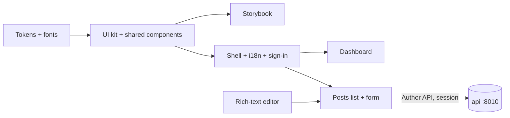

# Admin: design system, shell, sign-in, dashboard and the Posts screen

> **Run with:** `sonnet` / `medium` effort — mostly porting roshan-clinic components, with tests first.
> The Storybook, sign-in, editor and Post-form tasks (A5, B2, C3, C4) are rated L; under `prefer: cheapest` they still
> resolve to sonnet and escalate to opus after two identical failures.

## 1. Goal & scope

Build the Author's admin app (`admin/`) on a new **design system**: dark only, black and white, Persian right-to-left and English left-to-right. The screens follow roshan-clinic's dashboards (shell, data tables, dialogs, forms, stat cards). Posts is the one complete content screen, so the next plan can copy its patterns for the other seven kinds.

**In scope:**
- Design system: dark-only tokens, self-hosted fonts, the UI kit and shared components, Storybook, and four guard tests (contrast, no literal colours, spacing, RTL icons).
- Interface language (`en` default, `fa`) in a cookie; `lang` and `dir` follow it.
- Sign-in, sign-out, the signed-in gate, the shell and its navigation.
- Dashboard: stat cards and a recent-posts table.
- Posts: list with pagination and trash (restore), delete, and a create/edit form with EN/FA tabs, a rich-text body, per-language status and a cover image upload with alt texts.
- Documenting the Author lists' `deleted` query parameter in the OpenAPI schema, so the Trash tab is typed (A1).

**Out of scope:**
- Tags, Projects, Skill groups, Experience, Education, Images (library) and Profile screens — the next plan, reusing these patterns.
- A light theme — tokens stay in one place so it can be added later.
- Any API change beyond documenting the existing `?deleted=true` filter (A1), and any change to the public site or publishing.
- Playwright walkthroughs — `/run-app` is the browser check here.

## 2. Assumptions & open questions

**Safe assumptions:**
- Dark only: tokens are declared once in `:root` with `<html class="dark">` kept so library `dark:` variants resolve. Every colour token has chroma 0 (grayscale) except `destructive`, the single red, used for delete and error text only (`admin/src/app/globals.css`).
- Fonts are Vazirmatn (Persian) and Geist (Latin), self-hosted from `@fontsource-variable/*`. This replaces the Google Fonts fetch in `admin/src/app/layout.tsx:2`, which failed twice at build time.
- Interface language: cookie `app-lang`, default `en`, no `Accept-Language` sniffing; the admin is rendered on a server, so reading the cookie is fine. Persian digits are shown in `fa`.
- Spacing is the 4 px scale; only logical utilities (`start-`, `ms-`, `text-start`) are allowed, as in roshan-clinic.
- Porting means copy and adapt from `roshan-clinic/frontend/src/components/**`; the clinic-specific parts (Jalali pickers, practitioner swatches, calendar, clinic navigation) are not ported.
- `StatusBadge` shows three states: draft and published come from the API's `status`, and `empty` is derived (the item has no translation row in that language).
- The rich-text editor is Tiptap with `@tiptap/markdown`; the body is stored as Markdown only. A "Source" toggle shows the raw Markdown in a plain textarea so nothing the editor cannot represent is ever lost.
- The Post list has pagination only: the API has no search, sort or `updated_at`. Lists answer `{count, next, previous, results}` inside the envelope (`PaginatedPostList`, `admin/src/sdk/generated/types.gen.ts:156`). The generated list call has `page` and `page_size` but not `deleted` (`types.gen.ts:1301-1315`), although the API honours it (`api/src/apps/content/api/author_views.py:54-57`): A1 documents it and regenerates the SDK rather than hand-editing the generated folder.
- The `localhost:3001` origin is already allowed for CORS and CSRF (`api/.env.example:21-23`). The admin's committed default API URL is `http://localhost:8000` (`admin/.env`); on this machine the real port is 8010, set in the gitignored `admin/.env.local` and `api/.env`, so no file in the plan changes the port. Tags cannot be picked in the Post form yet (no Tag screens), and no existing image can be picked: the cover is uploaded in the form.
- A cover upload is `POST /api/author/images/`; its alt texts are then set with `PATCH /api/author/images/<uuid>/`, then the Post is saved with `cover_image: <uuid>` (`api/src/apps/content/api/author_views.py`).

**Residual risks / unknowns for reviewer:**
- Whether `@tiptap/markdown` round-trips headings, emphasis, lists, links, code and quotes without loss in both directions of text; C3 proves it with tests, and the Source toggle is the escape hatch.
- Whether Storybook 10 (`@storybook/nextjs-vite`) works with Next 16 and Tailwind 4 here; A5 verifies it and falls back to `@storybook/react-vite` plus the Tailwind Vite plugin.

**Bookkeeping:**
- Terms resolved → `admin/docs/CONTEXT.md` (created during the grill): Interface language, Content locale, Language status, Design system, Token, Shell, Trash.

## 3. Implementation tasks

### Phase A — Design system

- [x] **A1. Document the `deleted` filter and add the dependencies and scripts**
  - Files: `api/src/apps/content/api/author_views.py`, `admin/src/sdk/generated/` (regenerated), `admin/package.json`, `admin/pnpm-lock.yaml`, `admin/src/app/layout.tsx`
  - Change:
    - API: an `OpenApiParameter("deleted", bool)` on the Author lists (`extend_schema_view`, near `author_views.py:42`); regenerate the admin SDK with the API running.
    - Scripts: add `typecheck` (`tsc --noEmit`) next to the existing ones.
    - Dependencies: `react-hook-form`, `@hookform/resolvers`, `i18next`, `react-i18next`, `next-i18next`, `sonner`, `nuqs`, `@fontsource-variable/{vazirmatn,geist,geist-mono}`, `@tiptap/{react,pm,starter-kit,markdown}`.
    - Fonts: import the font CSS and drop `next/font/google` (`layout.tsx:2`).
  - Difficulty: M
  - Model: sonnet

- [x] **A2. Write the dark-only tokens**
  - Files: `admin/src/app/globals.css`
  - Change: black/white/gray tokens in `:root` (background, foreground, card, muted, border, input, ring, primary, secondary, accent, popover, scrim, `destructive`); remove the light/dark split and the unused `sidebar-*`/`chart-*` tokens; the font stack Geist, then Vazirmatn; `--spacing: 0.25rem`.
  - Difficulty: M
  - Model: sonnet
  - Contrast targets: 4.5 for text pairs, 3 for borders and rings, measured by the test in §4.

- [x] **A3. Port the UI kit**
  - Files: `admin/src/components/ui/` (new, from `roshan-clinic/frontend/src/components/ui/`), `admin/components.json`
  - Change:
    - Copy the 24 kit files: alert, avatar, badge, button, card, checkbox, dialog, dropdown-menu, field, input, label, popover, progress, select, separator, sheet, skeleton, sonner, switch, table, tabs, textarea, toggle, tooltip.
    - Keep tokens and logical utilities only; set `"rtl": true` in `components.json`.
  - Difficulty: M
  - Model: sonnet

- [x] **A4. Port the shared components and the formatting helpers**
  - Files: `admin/src/components/` (new), `admin/src/lib/format.ts` (new)
  - Change:
    - From `roshan-clinic/frontend/src/components/`: `PageHeader`, `StatGrid`, `EmptyState`, `LoadError`, `ConfirmDialog`, `FormDialog`, `FormErrorAlert`, `IconAction`, `UrlTabs`, `Wordmark`, `data-table/`, `Form/`.
    - New `StatusBadge` (replaces `ActiveStatusBadge`): empty, draft, published, each with an icon and a label, never colour alone.
    - `format.ts`: `toPersianDigits` and `isolateText`, from roshan-clinic `src/lib/format.ts`.
  - Difficulty: M
  - Model: sonnet

- [x] **A5. Add Storybook with RTL/LTR controls**
  - Files: `admin/.storybook/main.ts`, `admin/.storybook/preview.tsx` (new), `admin/package.json`, one `*.stories.tsx` next to every file in `admin/src/components/ui/` and every component from A4
  - Change: `storybook` and `build-storybook` scripts; a toolbar that switches `dir` and `lang` (strings arrive with B1); the dark class always on; the a11y addon.
  - Difficulty: L
  - Model: sonnet
  - Fallback if the Next framework package fails: `@storybook/react-vite` with `@tailwindcss/vite`.

### Phase B — Language, sign-in and shell

- [x] **B1. Add the interface language**
  - Files: `admin/src/i18n/` (new: `config.ts`, `client.ts`, `i18next.d.ts`, `locales/en/`, `locales/fa/`), `admin/src/app/layout.tsx`, `admin/src/components/LanguageSwitcher.tsx` and its story (new), `admin/.storybook/preview.tsx`
  - Change:
    - `next-i18next` in cookie mode (`localeInPath: false`, cookie `app-lang`, default `en`); the root layout reads the language and sets `<html lang dir>`.
    - Namespaces `common`, `auth`, `dashboard`, `posts`; the same keys in both languages.
    - The root layout also mounts the `nuqs` adapter (`nuqs/adapters/next/app`) that the table and tabs need.
    - Storybook's toolbar now switches the strings too.
  - Difficulty: M
  - Model: sonnet

- [x] **B2. Add sign-in, sign-out and the gate**
  - Files: `admin/src/features/auth/` (new: `use-session.ts`, `AuthGate.tsx`, `LoginScreen.tsx`, `sign-out.ts`), `admin/src/app/login/page.tsx` (new), `admin/src/app/layout.tsx`
  - Change:
    - `useSession` asks `Auth.authMe`; the gate sends a signed-out visitor to `/login`.
    - The login screen runs `loadCsrfToken` (`admin/src/sdk/session.ts:14`), `authLogin`, then `setCsrfToken` (`session.ts:10`) with the token it returns.
    - The root layout imports `admin/src/sdk/session.ts` once so the CSRF header hook is registered.
    - Wrong credentials and a refused request show a message in the interface language.
  - Difficulty: L
  - Model: sonnet

- [x] **B3. Build the shell and the navigation**
  - Files: `admin/src/features/shell/` (new: `ShellLayout`, `ShellSidebar`, `ShellHeader`, `ShellBottomNav`, `ShellUserMenu`, `nav.ts`), `admin/src/app/(app)/layout.tsx` (new)
  - Change:
    - From roshan-clinic's `features/shell`: a sidebar on wide screens, a bottom bar on a phone, a header with the language switcher and the user menu.
    - `nav.ts` lists Dashboard and Posts and is the one place the next plan adds the other kinds.
  - Difficulty: M
  - Model: sonnet

### Phase C — Dashboard and Posts

- [x] **C1. Build the dashboard home**
  - Files: `admin/src/features/dashboard/` (new), `admin/src/app/(app)/page.tsx`
  - Change: `StatGrid` cards for the number of Posts and Projects (the lists' `count`), and a table of the latest posts with their language status, each linking to its edit page; loading, empty and error states.
  - Difficulty: M
  - Model: sonnet

- [x] **C2. Build the Posts list with trash**
  - Files: `admin/src/features/posts/` (new: `PostsList.tsx`, `posts-columns.tsx`, `posts-service.ts`), `admin/src/app/(app)/posts/page.tsx`
  - Change: `DataTable` with `page` in the URL (`nuqs`); columns title (the first available language), slug, EN and FA `StatusBadge`; a Trash tab (`?deleted=true`) with a restore action; delete behind `ConfirmDialog`; empty, loading and error states.
  - Difficulty: M
  - Model: sonnet

- [x] **C3. Build the rich-text editor**
  - Files: `admin/src/components/rich-text/` (new: `RichTextEditor.tsx`, `Toolbar.tsx`, `markdown.ts`, `RichTextEditor.stories.tsx`)
  - Change:
    - Tiptap with `@tiptap/markdown`: the value in and out is a Markdown string.
    - A toolbar for headings, bold, italic, link, lists, quote, code and rule.
    - Each block uses `dir="auto"`, so Persian and English paragraphs each read correctly.
    - A Source toggle swaps to a plain textarea over the same Markdown.
  - Difficulty: L
  - Model: sonnet

- [x] **C4. Build the Post form**
  - Files: `admin/src/features/posts/` (`PostForm.tsx`, `post-schema.ts`, `CoverImageField.tsx`), `admin/src/app/(app)/posts/new/page.tsx`, `admin/src/app/(app)/posts/[uuid]/page.tsx`
  - Change:
    - Slug, then EN and FA tabs each with a `StatusBadge`: title, summary, the body (`RichTextEditor`) and a draft/published status.
    - Cover upload with per-language alt texts: upload, then alt `PATCH`, then save with the image uuid.
    - A published language needs a title and a body; API validation errors (`error_detail`) land on their field.
    - Create and edit.
  - Difficulty: L
  - Model: sonnet

## 4. Definition of done

- [x] The Author lists' `deleted` filter is documented and typed — verify: `api/src/apps/content/tests/test_schema_deleted_filter.py` — contract — every `/api/author/<kind>/` list operation in the schema has an optional boolean `deleted` query parameter; and `admin/src/sdk/__tests__/sdk.test.ts` — unit — `AuthorPostsListData['query']` in `admin/src/sdk/generated/types.gen.ts` contains `deleted`.
- [x] Every colour token is grayscale except `destructive`, text pairs hold 4.5:1 and borders and rings 3:1, and there is no light block — verify: `admin/src/app/__tests__/theme-tokens.test.ts` — unit — (red until A2; the three guard tests below pass on today's empty `src/` and then guard the ported code from A3 on) parses `globals.css`: only `:root` defines colours; chroma of every token is 0 except `destructive*`; `foreground/background`, `muted-foreground/background`, `primary-foreground/primary` and `destructive/background` reach 4.5; `border/background`, `ring/background` and `input/background` reach 3.
- [x] Nothing else writes a colour — verify: `admin/src/app/__tests__/no-literal-colors.test.ts` — unit — no hex, `rgb()`, `oklch()` or palette class (`bg-red-500`) in `admin/src` outside `globals.css`.
- [x] Spacing is on the 4 px scale — verify: `admin/src/app/__tests__/spacing-scale.test.ts` — unit — no half steps, and arbitrary `h-[…]`/`w-[…]`/`size-[…]` only as `var(--spacing…)`, a percentage or a viewport/container unit.
- [x] Right-to-left is logical — verify: `admin/src/app/__tests__/rtl-icons.test.ts` — unit — no physical `left`/`right`/`ml-`/`pr-` utility without a `// rtl-ok: reason`; directional icons carry `rtl:-scale-x-100` or `data-no-mirror`.
- [x] Both interface languages are complete and set `lang` and `dir` — verify: `admin/src/i18n/__tests__/locales.test.ts` — unit — `en` and `fa` define the same keys in every namespace; `getDir("fa") === "rtl"`, `getDir("en") === "ltr"`; the default language is `en`.
- [x] Persian digits and mixed text — verify: `admin/src/lib/__tests__/format.test.ts` — unit — `toPersianDigits("2026")` is `۲۰۲۶`; `isolateText` wraps a Latin run in `<bdi dir="ltr">`.
- [x] Signing in follows the CSRF handshake and the gate protects every screen — verify: `admin/src/features/auth/__tests__/auth.test.tsx` — integration — the SDK calls go `authCsrf`, `authLogin`, then the token is set; a 401 shows the message; a signed-out visit to `/` redirects to `/login`; sign-out clears the session.
- [x] The shell navigates and switches language — verify: `admin/src/features/shell/__tests__/shell.test.tsx` — integration — nav items come from `nav.ts` and the active one is marked; switching language writes the `app-lang` cookie and flips `dir`.
- [x] The data table, stat cards and dialogs behave — verify: `admin/src/components/__tests__/shared.test.tsx` — unit — `DataTable` renders rows, empty and error states and calls the page change; `StatGrid` shows the values; `ConfirmDialog` confirms and cancels.
- [x] The editor reads and writes Markdown without loss — verify: `admin/src/components/rich-text/__tests__/RichTextEditor.test.tsx` — unit — a document with headings, bold, italic, lists, a link, code and a quote round-trips to the identical Markdown; a Persian paragraph keeps `dir="auto"`; the Source toggle shows the same text.
- [x] The Posts list works — verify: `admin/src/features/posts/__tests__/posts-list.test.tsx` — integration — page 2 requests `page=2`; the Trash tab requests `deleted=true`; restore posts to `restore/` and refreshes; delete asks first; empty and error states render.
- [x] The Post form saves correctly — verify: `admin/src/features/posts/__tests__/post-form.test.tsx` — integration — EN and FA tabs show their own status; publishing without a title or body is refused on the form; an API `error_detail` shows on its field; a cover upload runs upload, alt `PATCH`, then the save with the image uuid.
- [x] The dashboard shows counts and recent posts — verify: `admin/src/features/dashboard/__tests__/dashboard.test.tsx` — integration — the cards show the lists' `count`; the table lists the latest posts and links to `/posts/<uuid>`.
- [x] Every UI and shared component has a story — verify: `admin/src/components/__tests__/stories.test.ts` — unit — every `*.tsx` directly in `components/ui/`, `components/`, `components/data-table/` and `components/rich-text/` (excluding `*.stories.tsx` and `*.test.tsx`) has a sibling `*.stories.tsx`.
- [x] The toolchain is green — verify: `cd admin && pnpm lint && pnpm typecheck && pnpm test && pnpm build && pnpm build-storybook` — command — all pass.
- [x] The screens work in a browser in both languages — verify: `/run-app` against the running API and admin — manual — sign in; the dashboard; create, edit, publish, delete and restore a Post; the language switch flips text and direction; no console errors; screenshots in dark RTL and LTR.

## 5. Risk & rollback

| Risk | Severity | Mitigation |
|---|---|---|
| The editor loses or rewrites Markdown it cannot represent | high | Round-trip tests (§4), a limited node set, and the Source toggle showing the exact text |
| A hue creeps in and breaks "black and white" | med | `theme-tokens` and `no-literal-colors` tests fail the build |
| RTL regressions (physical utilities, unmirrored icons) | med | `rtl-icons` test and Storybook's direction switch |
| Storybook 10 does not support this Next 16 / Tailwind 4 combination | med | Fallback to `@storybook/react-vite` (A5); the stories test keeps the contract either way |
| Session, CSRF or CORS fail across ports (3001 → 8010) | med | Covered by the auth test and the `/run-app` check; the 3001 origin is already allowed (`api/.env.example:21-23`) |
| A large port from roshan-clinic drags clinic-specific code in | low | Only listed components are ported; a grep for "clinic", "practitioner" and "jalali" in `admin/src` must be empty (review) |

- **Rollback:** `git revert` the plan's commits; `admin/` returns to the placeholder app and nothing else is touched.
- **Irreversible:** none: no API change, no data change.

## 6. Skills Needed

- `commit` (project) — for: every task — Conventional Commits, one per task.
- `squash-commit` (project) — for: the close-out — one commit per feature.
- `run-app` (project) — for: the browser check in §4 — start API and admin on free ports, drive the screens.
- `shadcn` (global) — for: A3 — component conventions and registry knowledge.
- `frontend-design` (global) — for: A2, A3, B3 — keeping the monochrome system distinctive and consistent.

## 7. Record (docs — /banna-build writes them)

- **Context** (`admin/docs/CONTEXT.md`) — created during the grill; the build keeps it in sync.
- **Convention** (`admin/docs/conventions/`, new) — rules: colours come only from tokens and only the red `destructive` has a hue (`adm-ui-01`); logical utilities only (`adm-ui-02`); every user-facing string exists in `en` and `fa` (`adm-i18n-01`); every shared component has a story (`adm-ui-03`); one folder per screen under `features/`, shared pieces in `components/` (`adm-str-01`).
- **Stack** (`admin/docs/stack.md`, new) — Storybook command, fonts self-hosted via fontsource, the editor and its Markdown storage, the cookie language.
- **Index** (`admin/CLAUDE.md`) — add the docs above and `pnpm storybook`.
- `admin/docs/README.md` is rewritten for what now exists: sign-in, the screens, the language, Storybook and the dev ports (api 8010 here, admin 3001); its "no i18n, no sign-in screen, no content screens" lines become false.
- No ADR: the colour and direction rules are enforced by tests (gate 2).

## Execution log

- Base commit: `fab58f3` on branch `feature/admin-design-system` (the previous branch `feature/content-models` is not merged; this work sits on top of it).
- Models: all tasks `sonnet`, run inline by the sonnet session.
- Tests for all phases were written once, in two red commits, so the contract was approved once.
- Frozen tests (api): `api/src/apps/content/tests/test_schema_deleted_filter.py` @ `dd993c0`
- Frozen tests (admin): `admin/src/app/__tests__`, `admin/src/i18n/__tests__`, `admin/src/i18n/test-utils.tsx`, `admin/src/lib/__tests__/format.test.ts`, `admin/src/features/auth/__tests__`, `admin/src/features/shell/__tests__`, `admin/src/features/posts/__tests__`, `admin/src/features/dashboard/__tests__`, `admin/src/components/__tests__`, `admin/src/components/rich-text/__tests__`, `admin/src/sdk/__tests__` @ `c4f73ef`
- Divergence from the plan text: `isolateText` wraps in Unicode isolates (as roshan-clinic's does), not `<bdi dir="ltr">`; the editor round-trip test asserts kept constructs plus stability, not byte-identical Markdown.
- A1: the API schema hook also writes `required: false` on optional parameters, because the frozen test asserts the key and the generator leaves it out. `pnpm add` needed `npm_config_fetch_timeout=300000` and concurrency 2 on this network (default settings dropped a tarball three times).
- A3: the kit uses `@/i18n/client` (dialog, sonner), which B1 creates, so `pnpm typecheck` stays red until B1 (the frozen tests import modules from later tasks too). `Input` lost roshan's digit-mode conversion (admin is bilingual); the switch thumb moves by `translate-x` so the spacing guard passes; sonner is dark and bottom-centre.
- A4: ported without roshan-clinic's API layer: `lib/api-errors.ts` reads this API's envelope (`result.error_detail`, `message`). Pagination formats digits by `i18n.language`; `Wordmark` is text only; `StatGrid` lost the `positive` tone. Components use i18n keys that B1 defines (`common`: `cancel`, `close`, `loading`, `retry`, `errors.*`, `table.*`, `languages.*`, `status.*`).
- Order: B1 was done before A5, because the ported components and the stories need `@/i18n/client` and the locales; no design change. `vitest.config.ts` inlines `next-i18next` (as roshan-clinic's does) so its client entry resolves `next/navigation`. `ConfirmDialog` passes `onOpenChange` a single argument, as the frozen test asserts. The Storybook toolbar part of B1 moves into A5.
- B2: test(amend) `ca969b8` adds `useParams: () => ({})` to the `next/navigation` mocks of the auth, shell, posts (2) and dashboard tests (the I18nProvider reads route params; the user delegated the call). Re-frozen: `admin/src/features/{auth,shell,posts,dashboard}/__tests__` @ `ca969b8`. `vitest.setup.ts` registers Testing Library `cleanup` (vitest has no globals). The login screen has no language switcher: the frozen Persian test requires exactly one button.
- B3: the shell has no theme toggle and no role menus (dark only, one author); `OptionSelect` was missed in A4 and is ported here because `SelectField` imports it.
- C1: a `StatTile` with an `href` is now one link over label, figure and hint (the frozen dashboard test reads the count inside the link); the stat grid waits for both counts before it shows.
- C3: the editor's labels live in `common.editor.*` (no new namespace); the story file moves into A5 with the rest of the stories.
- C4: the cover uploads on save (not on pick), so an abandoned form leaves no orphan image; alt texts apply to a newly chosen file only (an existing cover is replaced, its alt texts are not loaded). The root layout now mounts the `Toaster`. The SDK's `LocaleEnum` and `StatusEnum` are `const enum`s, so the form casts instead of importing them at runtime.
- A5: `@storybook/nextjs-vite` (the Next framework package worked; no fallback needed). 42 stories, one per component file. `pnpm build` needed `experimental.rootParams` because next-i18next's server entry imports `next/root-params`.
- Run-app (api :8010, admin :3001, browser pane): signed-out `/posts` redirects to `/login`; login, dashboard, Posts list, Post form, delete confirm, Trash and restore driven in Persian (RTL); dashboard and phone layout (375px) in English. Created a post through the form, deleted it, saw it in Trash, restored it. Defects found and fixed: the CSRF token was lost on a reload, so every save returned 403 (`useSession` now restores it); the active language tab hid its status badge (white on white); Next's dev badge covered the bottom bar. Known gap: a post in the Trash shows "(untitled)" because the API hides a deleted post's translation rows.
- Verified at close-out: `pnpm lint`, `pnpm typecheck`, `pnpm test` (80), `pnpm build`, `pnpm build-storybook`; api `pytest` (91) and `ruff`. Frozen checks passed against `c4f73ef`, `ca969b8` and `dd993c0`.
- Squashed onto `fab58f3` into four commits (design system; language, sign-in and shell; dashboard and Posts; Storybook, docs and the reload fix). The frozen shas above name the pre-squash commits; the tree is identical (proof printed by `squash.sh`).
